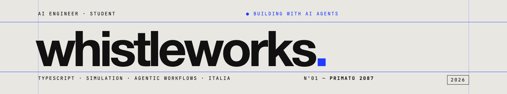
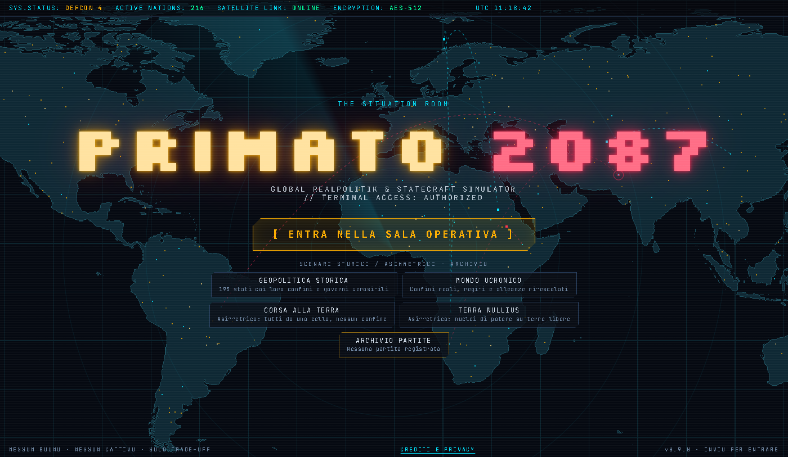

## Hi, I'm Alessio

I'm a student at Liceo Scientifico Farnesina in Rome, and I spend most of my free time programming. I mostly write TypeScript, and I use Claude Code as a coding assistant: I decide how things should work and check every change, and it helps me write the code a lot faster.

You can reach me at **fischetti.alessioo@gmail.com** or on [LinkedIn](https://www.linkedin.com/in/alessio-fischetti-831379439).

### PRIMATO 2087

My main project so far is a geopolitical strategy game that runs in the browser. You start with a new nation and grow it against 195 computer-controlled countries on a real world map, through the economy, trade, wars, elections and the occasional coup. It's free to play on [itch.io](https://whistleworks.itch.io/primato-2087) (the game is in Italian).

I did the game design, the structure of the code, the balancing and the release. The simulation engine is kept separate from the graphics, so I can also run it in Node without a browser. That's how I test it: one script plays a 60-year game and checks every month that the numbers still make sense. The whole thing is about 23,000 lines of TypeScript with no runtime dependencies, and even the music is generated live with the Web Audio API.

The source code is private, but I'm happy to show it if you ask.

© 2026 Alessio Fischetti
